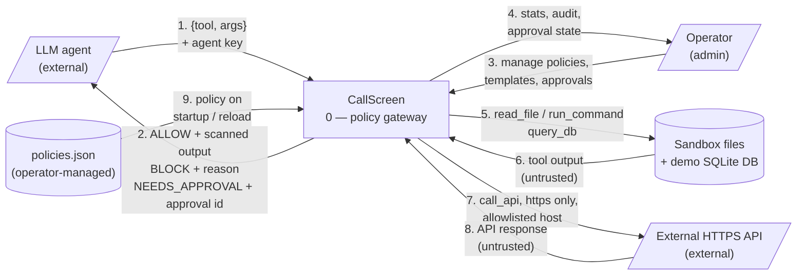
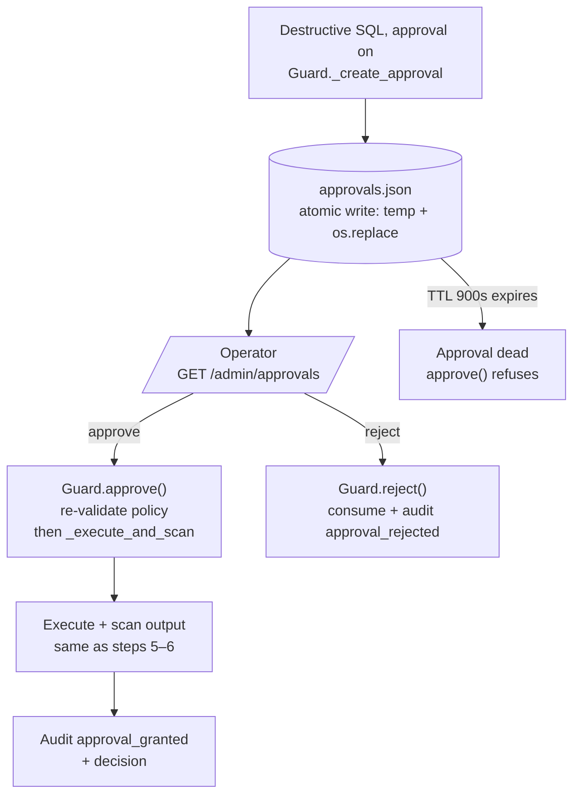
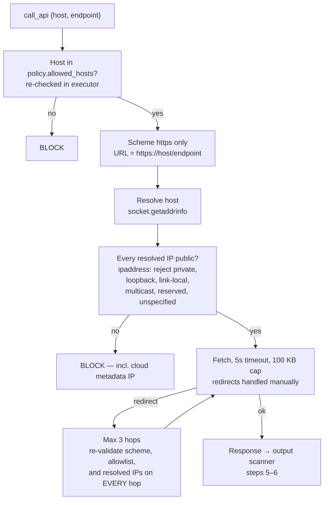

# CallScreen — Architecture & Data Flow

> Formerly **Agent Guard**. Renamed to CallScreen Nov 16, 2026. This doc
> describes the system as built (v0.3.0, 57 tests, verified Nov 2026).

CallScreen is a **policy gateway for LLM tool use**: a small, local-first,
Python-stdlib-only process that sits between an AI agent and its tools and
returns one of three decisions for every tool call — `ALLOW`, `BLOCK`, or
`NEEDS_APPROVAL` — with an audit trail for every decision. The core has zero
LLM code: it only ever sees `{tool, args}` and output text, so it is
model-agnostic (Ollama, OpenAI, Anthropic — see `examples/`).

Design invariants:

- **Fail closed at every step.** Malformed input, unknown key, expired key,
  rate-limit breach, unknown tool, bad arguments, injection in output — all
  BLOCK, never crash, never silently ALLOW.
- **Check both sides of the call.** Arguments are validated *before*
  execution; output is scanned *after* execution, before it returns to the
  agent. Tool output is data, not instructions.
- **Destructive actions never auto-execute.** They route to approval (or
  BLOCK if the policy has no approval path).
- **Every decision is audited.** Stats are derived from the audit log, not
  from a separate counter that can drift.

## 1. System architecture

```mermaid
flowchart TD
    subgraph Untrusted ["Untrusted — agent input, tool output, external network"]
        Agent["LLM agent / agent app<br/>sends {tool, args} + X-Agent-Key"]
        ExtAPI["External HTTPS APIs<br/>allowlisted hosts only"]
        ToolOut["Tool outputs<br/>files, DB rows, API responses"]
    end

    subgraph Local ["CallScreen — single process, local-first, stdlib only"]
        Server["HTTP server<br/>ThreadingHTTPServer<br/>POST /tool, GET /health, /admin/*"]
        Guard["Guard — decision engine<br/>RLock around handle / approve / reject"]
        Policy["Policy model<br/>allowlist, rate limit, hosts,<br/>tables, tenant, expiry"]
        Limiter["RateLimiter<br/>sliding window, 60s<br/>per-agent + per-tool"]
        Validator["Argument validators<br/>paths, SQL, commands, hosts"]
        Scanner["Output scanner<br/>regex: injection, secrets, PII<br/>NFKC + leetspeak + base64"]
        Executor["Executor<br/>mock tools.py by default<br/>real_tools.py if REAL_TOOLS=1"]
        Approvals["Approvals<br/>TTL 900s, persistent JSON"]
        Audit["Audit sinks<br/>JSONL or SQLite"]
        AdminUI["Admin UI + API<br/>policies, stats, templates, approvals"]
    end

    subgraph Stores ["Local data stores — files"]
        PolFile[("policies.json<br/>POLICIES_PATH")]
        ApprFile[("approvals.json<br/>APPROVALS_PATH")]
        AuditFile[("audit.jsonl / audit.db<br/>AUDIT_BACKEND, AUDIT_PATH")]
        Sandbox[("data/ sandbox<br/>+ data/demo.db (SQLite)")]
    end

    Agent -->|"POST /tool {tool, args}"| Server
    Server --> Guard
    Guard --> Policy
    Guard --> Limiter
    Guard --> Validator
    Guard --> Executor
    Executor -->|"read_file / run_command"| Sandbox
    Executor -->|"query_db"| Sandbox
    Executor -->|"call_api, https only"| ExtAPI
    Executor -->|"raw output"| Scanner
    Scanner -->|"ALLOW / BLOCK / redacted ALLOW"| Guard
    Guard --> Approvals
    Guard --> Audit
    AdminUI --> Guard
    AdminUI --> PolFile
    AdminUI --> ApprFile
    AdminUI --> AuditFile
    Policy --> PolFile
    Approvals --> ApprFile
    Audit --> AuditFile
    ToolOut -.->|"untrusted data"| Scanner
```



### Component map

| File | Responsibility |
|---|---|
| `callscreen/server.py` | `ThreadingHTTPServer`. `POST /tool`, `GET /health`, `/admin/*` (UI, policies, stats, templates, approvals, reload). `MAX_BODY_SIZE = 1_000_000` (413 over). Admin: `ADMIN_KEY` via `hmac.compare_digest`, else loopback only, else 403. Env: `HOST`, `PORT`, `ADMIN_KEY`, `POLICIES_PATH`, `AUDIT_BACKEND`, `AUDIT_PATH`, `REAL_TOOLS`, `APPROVALS_PATH`, `GENERIC_TOOL_REASONS`. |
| `callscreen/guard.py` | Decision engine. `handle()` → `_handle_locked()` under a coarse `RLock`. Auth, expiry, rate limits, allowlist, arg validation, destructive-SQL routing, `_execute_and_scan()`, `approve()` / `reject()`, `list_approvals()`, policy CRUD. |
| `callscreen/policy.py` | `Policy` dataclass + `load_policies` / `save_policies` + `from_dict` validation. Fields: agent key/id, `allowed_tools`, `rate_limit_per_minute` (1–1000), `requires_approval_for_high_risk`, `allowed_hosts`, `sandbox_root`, `allowed_tables` (empty = no restriction), `tenant_id` (default `default`), `expires_at` (epoch or `None`). |
| `callscreen/scanner.py` | Output scanning. `_normalise` (NFKC, zero-width/punct stripped, leetspeak, base64 decoded once), `_is_injection`, `scan_output` → BLOCK on injection, redact secrets/PII. Deterministic regex, auditable reason. |
| `callscreen/tools.py` | Mock executor (default). Sandboxed fixtures, incl. planted injection/PII/secret strings for scanner tests. |
| `callscreen/real_tools.py` | Real executor, opt-in (`REAL_TOOLS=1`). `read_file` (sandbox, 100 KB cap), `run_command` (`ls`/`echo` only, no shell, 5s timeout), `query_db` (real SQLite demo DB, `findings` + `users`, single statement), `call_api` (real HTTPS with SSRF checks — see §4). |
| `callscreen/audit.py` | `AuditLog` (JSONL, default `audit.jsonl`), `SqliteAuditLog`, `make_audit_sink()`. Every decision appended: agent, tool, decision, reason, tenant. |
| `callscreen/templates.py` | 7 policy templates (safest first: `lockdown`, `research-readonly`, `data-analyst`, `support-api`, `ci-compliance`, `ops-limited`, `sandbox-developer`). |
| `callscreen/manage.py` | CLI: `python3 -m callscreen.manage` (add/list/edit policies, incl. `--template`). |
| `callscreen/fuzz.py` | Fuzzer: invariants are never crash, valid decisions only, destructive SQL / outside-sandbox / unknown tool never ALLOW, output secrets never leak. |
| `eval/scanner_eval.py` | Scanner eval. Core corpus 20 benign / 12 injection = 0 FP / 0 FN. Hard corpus 12 benign / 17 injection = 2 FP / 12 FN. Core gates CI; hard is reported, not gated. |
| `eval/scenarios.json`, `simulation.py` | 17-scene end-to-end simulation (7 ALLOW, 8 BLOCK, 2 NEEDS_APPROVAL). |

### Trust boundaries

- **Untrusted:** agent-supplied keys/args, every tool output, every external
  API response, anything reachable over the network if the server binds
  `0.0.0.0`.
- **Trusted:** the policy file, `ADMIN_KEY`, local store files, the operator
  at the admin UI.
- **Admin protection (pentest fix):** with `ADMIN_KEY` set, `/admin/*`
  requires it; without it, admin is loopback-only and returns 403
  otherwise, plus a startup warning. `GENERIC_TOOL_REASONS=1` returns
  `reason: "blocked"` for every BLOCK (closes the reason-oracle that
  distinguished unknown keys from wrong tools); detail stays in the audit
  log only.
- **9 protected rules** are hard-coded in guard/scanner/real_tools and
  cannot be disabled by any policy, template, or UI edit: `sandbox_only`,
  `no_dangerous_commands`, `no_outside_hosts`, `no_auto_destructive`,
  `unknown_is_block`, `output_is_scanned`, `table_allowlist`,
  `rate_limit_cannot_be_unlimited`, `expired_key_is_block`.

## 2. DFD Level 0 — context

One process, four external actors. The agent is the only caller of the
decision path; the operator manages policy; the tools and the network are
data sources the guard does not trust.



## 3. DFD Level 1 — the Guard pipeline

This is `Guard._handle_locked()`, in order. Every step that fails returns
BLOCK (or NEEDS_APPROVAL at step 5) and audits the decision. Nothing after
a failed step runs.

```mermaid
flowchart TD
    A[/"Agent request<br/>POST /tool"|] --> B["0. Malformed input?<br/>bad types, NUL bytes"]
    B -->|yes| BLOCK1["BLOCK malformed_request / malformed_args<br/>+ audit"]
    B -->|no| C["1. Authenticate<br/>key → policy"]
    C -->|unknown key| BLOCK2["BLOCK unknown_agent_key + audit"]
    C -->|known| D["1b. Key expired?<br/>now > expires_at"]
    D -->|yes| BLOCK3["BLOCK key_expired + audit"]
    D -->|no| E["2. Rate limit<br/>sliding window 60s<br/>per-tool AND per-agent"]
    E -->|over limit| BLOCK4["BLOCK rate_limit_exceeded + audit"]
    E -->|ok| F["3. Allowlist<br/>tool in policy.allowed_tools?"]
    F -->|no| BLOCK5["BLOCK tool_not_allowed + audit"]
    F -->|yes| G["4. Validate arguments<br/>path / SQL / command / host"]
    G -->|invalid| BLOCK6["BLOCK + reason + audit"]
    G -->|valid| H["4b. Destructive SQL?<br/>non-SELECT or DESTRUCTIVE_SQL"]
    H -->|yes, approval on| I["NEEDS_APPROVAL<br/>create approval, persist<br/>approvals.json, audit"]
    H -->|yes, approval off| BLOCK7["BLOCK destructive_sql_blocked + audit"]
    H -->|no| J["5. Execute tool<br/>mock, or real if REAL_TOOLS=1"]
    J --> K["6. Scan output<br/>injection → BLOCK<br/>secret/PII → redact"]
    K --> L["7. Audit decision<br/>agent, tool, decision,<br/>reason, tenant"]
    L --> M[/"Response to agent<br/>ALLOW + output / BLOCK / NEEDS_APPROVAL"/]
    I --> M
```

### Step 4 — argument validation, per tool

| Tool | Validation (all fail closed) |
|---|---|
| `read_file` | Path canonicalised (`_canonical_sandbox_path`); must stay inside `sandbox_root`. No `..` escape, no absolute escape. |
| `run_command` | Dangerous commands blocked; shell metacharacters (`;`, `|`, `&`, backticks, `$`, `>`, `<`) rejected. Real executor: only `ls` / `echo`, no shell, 5s timeout. |
| `query_db` | Must be a single read-only `SELECT`/`WITH` (`_is_single_read_only_query`, comments stripped). Table must be in `allowed_tables` when set. Anything else is step 4b, never auto-executed. |
| `call_api` | Host must be in `allowed_hosts`; endpoint must match `ENDPOINT_RE`; https only (real executor). |

## 4. DFD Level 2 — approvals and the real `call_api` (SSRF)

### 4a. Approval flow



Approvals are persistent across restarts (`APPROVALS_PATH`, default
`approvals.json`; `""` = in-memory only). `approve()` re-validates the
policy before executing — an approval granted yesterday does not bypass
today's policy. Approval IDs are full 32-char UUID hex; the agent key is
stripped from the `/admin/approvals` API response.

### 4b. Real `call_api` — SSRF checks



**Documented residual risk:** DNS is re-resolved per hop and the fetch
uses the hostname, so a record changing between check and connect
(DNS-rebinding race) is not fully pinned to one IP. The pinned-IP client
is the explicit next step — it is the feature picked for the next push
after this doc. No live external fetch has been tested; protections are
unit-tested with mocked DNS/HTTP (`tests/test_ssrf.py`, 4 tests).

## 5. Data stores

| Store | File / env | Contents | Who writes | Who reads |
|---|---|---|---|---|
| Policies | `policies.json` (`POLICIES_PATH`) | Agent keys, allowlists, limits, hosts, tables, tenant, expiry | Operator via admin UI/CLI, `save_policies` | Guard on startup/reload |
| Approvals | `approvals.json` (`APPROVALS_PATH`) | Pending approvals: id, agent, tool, args, expiry | Guard on create/consume | Guard, admin API |
| Audit | `audit.jsonl` or `audit.db` (`AUDIT_BACKEND`, `AUDIT_PATH`) | One record per decision: time, agent, tool, decision, reason, tenant | Guard (`_audit`) | Admin stats, operator |
| Sandbox | `data/` + `data/demo.db` | Mock fixtures (incl. planted injection/PII test strings), real demo DB tables `findings`, `users` | Real executor (read-only queries), fixtures at build time | Real/mock executor |
| Eval corpora | `eval/scanner_eval.py`, `eval/scenarios.json` | Core + hard scanner corpora, 17-scene simulation | Maintainer | CI, `eval/` |

All three runtime stores are files, excluded from git via `.gitignore`
(`audit.jsonl`, `audit.db`, `approvals.json`, `policies.json` are runtime
state, not repo content). Demo agent keys in the repo (`key-research-123`,
`key-ops-456`) must be rotated before any real deployment.

## 6. Threats → controls

From `DESIGN.md` §3 and `PENTEST.md` (73 cases, 72 held, 1 Low bypass:
the reason-oracle, mitigated by `GENERIC_TOOL_REASONS=1`).

| Threat | Control in the flow |
|---|---|
| Indirect prompt injection in tool output | Step 6 scans every output before the agent sees it; injection → BLOCK. |
| Secret / PII exfiltration via output | Step 6 redacts secrets/PII; audit stores redacted args only. |
| Path traversal (`../`, absolute escape) | Step 4 canonicalises paths against `sandbox_root`. |
| Destructive commands / shell chaining | Step 4 rejects shell metacharacters and dangerous commands; real executor allows only `ls`/`echo`, no shell. |
| Destructive SQL (DROP/DELETE/INSERT/ALTER/…) | Step 4b: never auto-executed; approval or BLOCK. |
| SSRF / metadata endpoint / private hosts | §4b: allowlist + public-IP check + redirect re-validation. Residual: DNS-rebinding race (pinned-IP client next). |
| Agent looping a tool to exfiltrate / brute-force | Step 2: sliding-window limits per-tool and per-agent (pentest fix: per-tool-only allowed 90/min across 3 tools). |
| Stolen / long-lived keys | Step 1b: `expires_at`; tenant-scoped keys; rotation required for demo keys. |
| Unauthenticated admin takeover | Admin requires `ADMIN_KEY` (constant-time compare) or loopback; otherwise 403. |
| Policy tampering via template/UI | 9 protected rules are hard-coded, not policy fields; templates cannot disable them. |
| Audit tampering / missing decisions | Every decision audited, including malformed input; stats derived from the log. (Tamper-evidence/signing is future work.) |

## 7. Known limits (stated, not hidden)

- **Coarse lock:** the Guard `RLock` serialises `handle()` calls including
  executor work. Threading is concurrency safety, not throughput — at
  100 agents / 1,000 req/s the lock breaks first, then audit I/O, then
  `ThreadingHTTPServer` thread-per-connection, then in-process state
  (rate limits reset on restart, approvals are a whole-file rewrite).
- **Single process, no TLS, no SSO.** Production needs a reverse proxy
  with TLS and real auth in front, `ADMIN_KEY` set, demo keys rotated.
- **Scanner is regex, not a classifier.** Core corpus 0 FP / 0 FN; hard
  corpus 2 FP / 12 FN (70.6% FN). A classifier backend is in progress,
  judged against the regex baseline on the hard corpus — it only becomes
  default if it clears the bar (hard FN < 10%, hard FP < 5%, core 0/0).
- **Mocks by default.** The mock executor proves decision logic, not
  sandbox-escape resistance. Real execution needs a container sandbox
  (future work).
- **DNS-rebinding race** in real `call_api` (§4b). Pinned-IP client is
  the next feature.
- **CI not live yet:** `.github/workflows/ci.yml` is not on GitHub (App
  token gets 403 on `.github/workflows/*`); it must be pushed via git.
